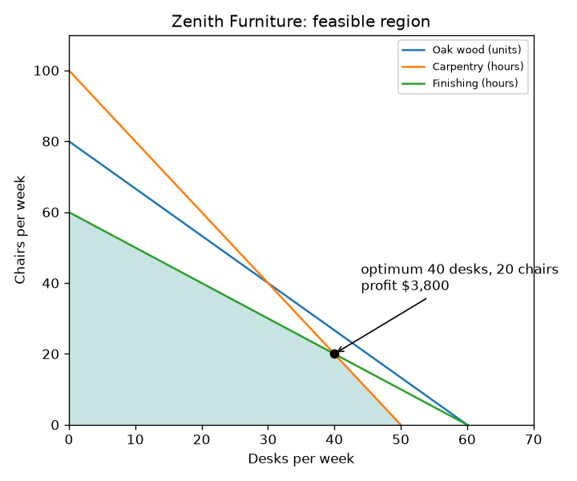

# Operations Research Algorithms from Scratch

Classic operations research and decision analysis methods implemented in plain
Python and NumPy, without any solver library, and tested against SciPy.

It started as my own Python solutions to exercises from my Business Analytics courses
at Tunis Business School (Business Optimization, Decision & Game Theory, Production &
Operations Management). I then generalized them into reusable, tested solvers.

| Module | Method | Handles |
|---|---|---|
| `simplex.py` | Two-phase simplex (tableau) | max/min, `<=` `>=` `=` constraints, negative right-hand sides, redundant rows, infeasible and unbounded problems, anti-cycling (Bland's rule), shadow prices, slacks, reduced costs, tableau-by-tableau trace |
| `hungarian.py` | Hungarian method (assignment problem) | square and rectangular matrices, minimization or maximization |
| `decision_tree.py` | Decision trees by backward induction | decision and chance nodes, nested sequential decisions, costs or profits, value of information |
| `decision_criteria.py` | Decisions under uncertainty and risk | maximax, maximin, Hurwicz, Laplace, minimax regret, expected value (EMV), EVPI |

## Worked business cases

### 1. Production mix (linear programming)
Zenith Furniture makes desks ($70 profit) and chairs ($50) with limited oak, carpentry
and finishing capacity.

```
python -m examples.zenith_production_mix --steps --plot
```

```
Executive desks      40      Oak wood     slack 20   shadow price  $0
Ergonomic chairs     20      Carpentry    slack  0   shadow price $20
Profit           $3,800      Finishing    slack  0   shadow price $30
```
Finishing is the tightest bottleneck: one extra finishing hour is worth $30 of weekly
profit, while extra oak is worth nothing.



### 2. Assignment (Hungarian method)
Three technicians, three jobs, minimize total cost. Optimal plan: A→1, B→3, C→2 for 550 TND.
```
python -m examples.assignment_case
```

### 3. Sequential decision (decision tree)
An art dealer decides each day whether to buy a painting that may be sold to someone else.
Buying on day 1 is optimal (expected value $10,000); perfect information would be worth $2,240.
```
python -m examples.dealer_decision_tree
```

### 4. Production plan under strike uncertainty (decision criteria)
Every classic criterion on the same payoff table: the expected-value decision is to produce
for 2 weeks (165,000 TND), and perfect information about the strike is worth 16,000 TND.
```
python -m examples.strike_production_plan
```

## Use it in your own code

```python
from or_algorithms import solve_lp, hungarian, DecisionNode, ProbabilityNode

result = solve_lp(c=[3, 5], A=[[1, 0], [0, 2], [3, 2]], b=[4, 12, 18],
                  senses=['<=', '<=', '<='], maximize=True)
print(result.summary())
```

## How it is tested

`pytest` runs 371 tests, including:
- **150 random linear programs** (2–6 variables and constraints, mixed `<=`/`>=`/`=`) solved by
  both this simplex and SciPy's HiGHS solver: same status (optimal / infeasible / unbounded),
  same optimum, feasible solution, and shadow prices that form a valid optimal dual
  (strong duality and dual feasibility).
- **200 random assignment problems** (square and rectangular) checked against
  `scipy.optimize.linear_sum_assignment`.
- Known textbook results: Beale's cycling example, redundant equalities, the course cases above.

## Run it

```
python -m venv .venv
.venv\Scripts\pip install -r requirements.txt     # Windows (use .venv/bin on macOS/Linux)
.venv\Scripts\python -m pytest
```

Requirements: Python 3.10+, NumPy, pandas, Matplotlib (plots). SciPy and pytest are only used by the tests.
